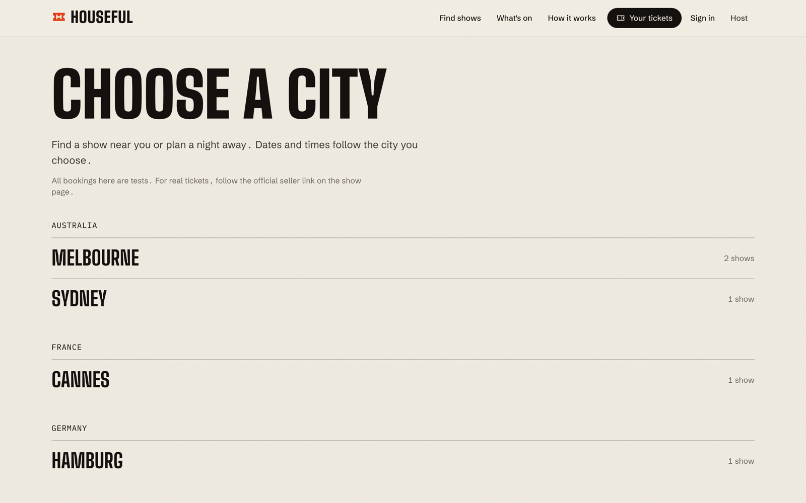
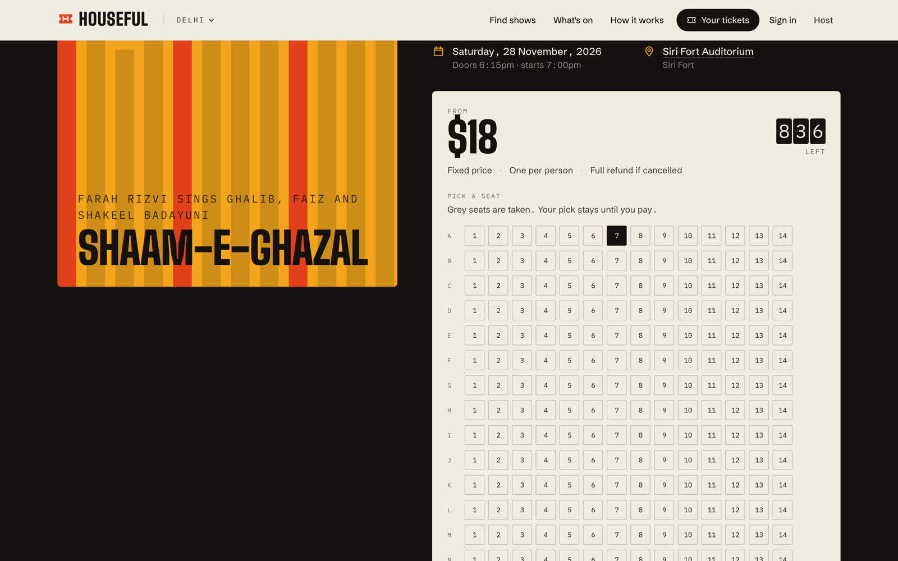
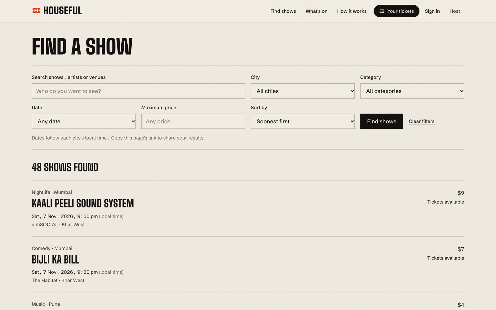
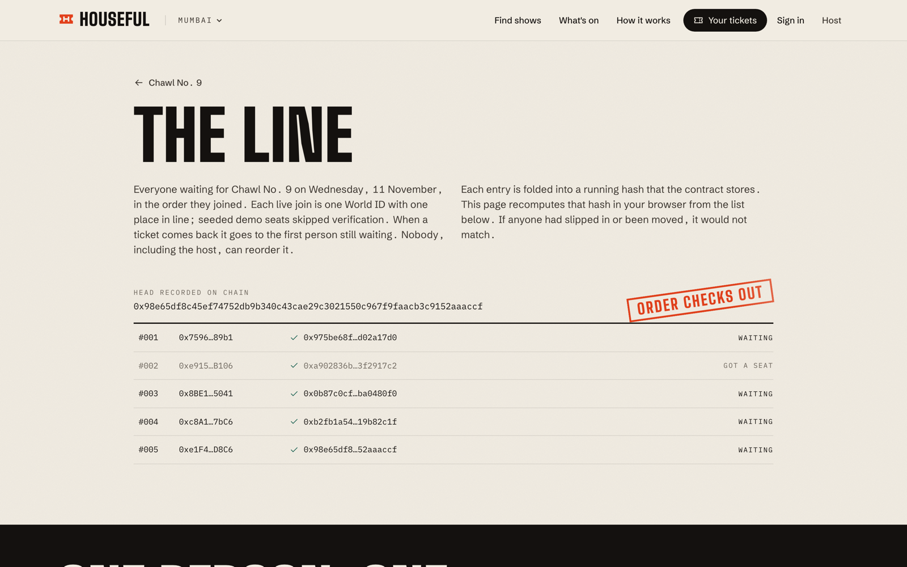
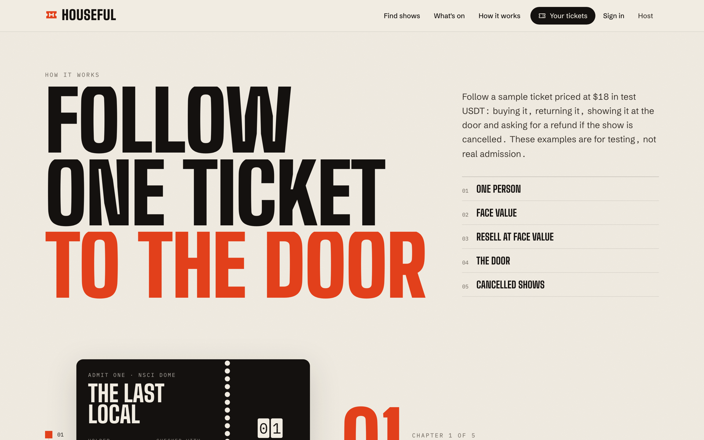

# Houseful

One person, one ticket per show, at a fixed price.

**Live demo:** https://houseful-chxmqs-projects.vercel.app (test network, test money). The booth cut shows **Mumbai · New York · London · Tokyo** from the header toggle.

**Before you sign in:** the hosted app asks World for its staging environment, so a real World App scan will not complete a check here. Use World's simulator at https://simulator.worldcoin.org, through the link in the World prompt. Staging checkout asks for Proof of Human. A recorded staging run, with its limits, is in [docs/evidence/world-staging-run](docs/evidence/world-staging-run/).

Houseful is a testnet ticketing prototype built for ETHGlobal Mumbai 2026. Fans pick seats where offered, pay at the face-value dollar price, and return unwanted tickets before a cutoff. The “Resell at face value” action returns the ticket through the contract, refunds its face value and gives the same seat to the oldest active waiter in the same transaction, or puts it into the returned-ticket pool. Ordinary transfers and approvals revert. Settlement under the hood is test USDT on Unichain Sepolia; ETH checkouts swap exact face value through Uniswap in the same transaction, without exposing that path in the fan UI.

The human check is a server trust boundary: the server verifies a World ID proof and signs an attestation that the contract accepts. The contract does not verify World ID itself. Selling a wallet key or lending an identity remains possible. See [the threat model](docs/threat-model.md).

## Screenshots











## What is implemented

- Catalog, city and category pages, search and URL filters, event pages, checkout, a seat map, tickets, waitlist ledger, host listing and host console.
- Header city toggle for the four demo hubs: Mumbai, New York, London and Tokyo. Seed keeps only those cities for the booth cut.
- Checkout wallet picker: this phone, MetaMask / browser wallet, or a linked address. Booking locks the screen through World ID and payment; minting and waitlist joins show step progress.
- Face-value prices in dollars. Settlement is test USDT with six decimals; ETH payments use an exact-output Uniswap v3 swap. Refunds and host proceeds are paid in USDT.
- Single-use, wallet-bound EIP-712 attestations, seat uniqueness, a public waitlist, cancellation refunds, and host withdrawal after the event ends.
- A device wallet and door signing key stored in localStorage. There is no key export/import UI (that path enabled off-platform ticket sales).
- World ID fan sign-in at `/login`, browser-wallet host sign-in at `/host/login`, cookie sessions and an `/account` wallet-address list. `/tickets` and `/account` require a fan session; `/host` and `/host/new` require a host session.
- Rotating door codes and a scanner that checks them locally after a sync. A synced scanner rejects older ownership generations. Screenshots can still work on a fresh scanner for about 20 to 40 seconds.
- Demo Devcon listing at `/e/devcon-mumbai` with a custom poster for the purchase flow.

[The v2 specification](docs/specs/v2.md) includes work beyond the implementation. Account integration remains partial: adding a wallet address does not prove ownership, because linking has no signature challenge. Checkout signs with the account's active linked wallet through an injected browser wallet, or with the device wallet when that is the active one, and host actions sign with the wallet that proved the host login. The listing server action requires a host session. Delinking checks all catalog events for a held ticket, including ended shows, but ignores waitlist places and uncataloged events. These seams are PENDING(account-integration).

Checkout first requests an attestation from the fan session and opens World verification when there is no session credential that meets the show's requirement. Login and checkout use the same World action, `houseful-login` (see `worldActionFor` in [assurance.ts](apps/web/src/lib/assurance.ts)), so one person has one identity on both paths, and the contract refuses a second place for that identity at the same show. A Proof of Human show after a Selfie Check login needs a second World check on that same action, and that path has not been run live. The session endpoint supports recovery signatures, but there is no complete recovery UI. Signing in on another phone does not restore the device wallet key; World-proven `recoverTicket` is the intended move path and is PENDING(recovery-ui). PENDING(identity-continuity).

The seed still builds from Mumbai samples plus worldwide research drafts, then keeps only the four demo cities for local and booth use (`DEMO_CITY_SLUGS` in [demo-cities.ts](apps/web/src/lib/demo-cities.ts); hub pad via [seed-demo-hubs.ts](apps/web/scripts/seed-demo-hubs.ts)). Every seeded listing has a chain event id, but assigning an id does not establish that the chain has been seeded. Dollar prices are test USDT amounts, not live seller quotes.

Unknown public facts are shown as “Not published”, including unconfirmed start times, doors, end time, age, duration and venue capacity. Internal settings such as a 100-place test allocation or a fallback booking window are separate from official event facts. Dates display in each city's timezone; search calendar filters use that timezone, while the older city-page time-window helper still uses IST. Catalog counts and seeded attendance are not proof of real ticket sales. PENDING(returned-seat-checkout): a returned seated ticket is reserved on chain but disabled in the current seat picker; see [the checkout handoff](docs/notes/contract-review.md#integration-handoff). See [the import policy](docs/notes/catalog-import.md), [catalog builder](apps/web/scripts/worldwide-catalog.ts) and [published-fact rules](apps/web/src/lib/catalog-facts.ts).

## Evidence and remaining demo work

`PENDING(name)` anywhere in these docs marks something that was not checked or run before submission.

| Item | Recorded evidence and limit |
| --- | --- |
| Chain | Unichain Sepolia, chain id `1301`; [deployment record](packages/contracts/deployments/1301.json) |
| Houseful | [`0x8F9A0dfb0BC16526FB4df5d9774ea6D6e2aBa98e`](https://sepolia.uniscan.xyz/address/0x8F9A0dfb0BC16526FB4df5d9774ea6D6e2aBa98e) |
| Live Uniswap route | [Recorded ETH purchase transaction](https://sepolia.uniscan.xyz/tx/0x8ca75ec0da716d5469bf4706232a47ee5eb19a0e3702055de304e0bfe785780f), also documented in [FEEDBACK.md](FEEDBACK.md) |
| World ID | The 7 November staging run recorded `/api/world/verify` returning 200 after simulator approval at 03:55:52 IST. This is staging proof verification, not a production World App run. [Run record and screenshots](docs/evidence/world-staging-run/). |
| Browser purchase after World verification | PENDING(live-purchase). That run failed at the USDT approval because the public RPC rejected `eth_sendTransaction`; no ticket was minted. Commit `2b8b70d` now passes the wallet's local account through simulation so writes can be signed locally. A fresh successful live run is still needed. |
| Alternative World path | In that run, declining in the simulator left the modal connecting; closing the modal showed “Verification was cancelled. Nothing was charged.” |
| Second wallet, same simulated person | The second attempt received World HTTP 502, shown as “World rejected the proof (HTTP 502).” No faucet or purchase followed. This did not exercise the intended already-holds refusal because no ticket had been minted. |
| Hosted demo | https://houseful-chxmqs-projects.vercel.app on Vercel with a Turso database. It opens without a sign-in wall, at `/mumbai`. A check from a phone on another network, and a full World simulator journey on the hosted site, are not recorded. See the [hosting notes](docs/notes/hosting.md). |
| Local verification, 7 November | Web typecheck passed; 83 pass-library tests, 55 contract tests and 20 discovery browser checks passed. The web unit tests were re-run on 7 November at 08:07 IST: 284 passed in 5 files. Discovery ran on desktop and 375px phone layouts, including a production build and all 49 local chain listings. `pnpm --filter web lint` exits 0 with no output on the committed tree. |
| Supplemental contract typecheck | Fails in the older `packages/contracts/scripts/seed-local.ts:41`, which omits `seated`. The contract tests pass independently. |

The [World integration debrief](docs/notes/world-debrief.md) records time to first server verification, the failed payment, the simulator decline behavior and the second-wallet 502. It separates the observed staging proof success from the still PENDING live purchase and duplicate-ticket refusal. The highest-impact requested improvement is a visible copyable connection link with a completed, cancelled or failed status returned to the app.

## World ID: why this credential

The trust moment is taking one scarce seat at a fixed price. One person holding many seats takes them from everyone else, and a face-value ticket has no resale margin that would price that in, so the thing to stop is one person buying through many wallets.

The server sets the minimum credential for each show in [`assuranceFor`](https://github.com/chxmq/houseful/blob/2001a62/apps/web/src/lib/assurance.ts#L18-L22). A Selfie Check is enough for ordinary shows: it stops one person farming wallets and asks for no document or Orb visit. A show that is sold out, or that holds 5,000 or more people at $18 or more, asks for Proof of Human, because demand above supply attracts organised buying. The two thresholds are product choices, not measurements. The limit is stated in the code: a wallet key can still be sold off the platform, and no credential prevents that.

Every proof is checked with World's verify API on the server before an attestation is signed. A weaker credential than the show needs is refused, and the contract accepts each attestation once. The refusals in the code are a weaker credential, a ticket already held, World unreachable, and a prompt the fan closes, which is reported as cancelled. Only the cancelled prompt has been seen on a live staging run (see the evidence above). The others have stubbed end-to-end specs but no live run.

## Where the prize integrations are

Links are pinned to commit `2001a62`. These files are unchanged between it and the latest commit.

| What | Where |
| --- | --- |
| World: the request is signed on the server | [`createWorldRequest`, world.ts L15 to L31](https://github.com/chxmq/houseful/blob/2001a62/apps/web/src/server/world.ts#L15-L31) |
| World: the proof is checked with World's verify API | [`verifyWorldProof`, world.ts L97 to L196](https://github.com/chxmq/houseful/blob/2001a62/apps/web/src/server/world.ts#L97-L196), with the call to World at [L135](https://github.com/chxmq/houseful/blob/2001a62/apps/web/src/server/world.ts#L135) |
| World: the credential rule | [`assuranceFor`, assurance.ts L18 to L22](https://github.com/chxmq/houseful/blob/2001a62/apps/web/src/lib/assurance.ts#L18-L22) |
| World: the contract admits only a signed, single-use attestation | [`_admit`, Houseful.sol L676 to L693](https://github.com/chxmq/houseful/blob/2001a62/packages/contracts/contracts/Houseful.sol#L676-L693) |
| World: IDKit in the browser | [verify-human.tsx](apps/web/src/components/verify-human.tsx) for checkout and [world-login.tsx](apps/web/src/components/auth/world-login.tsx) for sign-in |
| Uniswap: ETH is swapped for the exact ticket price | [`_swapEthForFaceValue`, Houseful.sol L749 to L772](https://github.com/chxmq/houseful/blob/2001a62/packages/contracts/contracts/Houseful.sol#L749-L772) |
| Uniswap: the quote shown before paying | [`quoteEthForUsdt`, ticket-actions.ts L244 to L268](https://github.com/chxmq/houseful/blob/2001a62/apps/web/src/lib/ticket-actions.ts#L244-L268) |
| Uniswap: the pool is created and seeded | [seed-pool.ts, from L81](https://github.com/chxmq/houseful/blob/2001a62/packages/contracts/scripts/seed-pool.ts#L81) |
| Uniswap: a real ETH purchase | [prove-uniswap.ts, L106](https://github.com/chxmq/houseful/blob/2001a62/packages/contracts/scripts/prove-uniswap.ts#L106) and the [transaction](https://sepolia.uniscan.xyz/tx/0x8ca75ec0da716d5469bf4706232a47ee5eb19a0e3702055de304e0bfe785780f) |

## Uniswap integration

The exact swap implementation is [`_swapEthForFaceValue` in Houseful.sol](packages/contracts/contracts/Houseful.sol). It calls SwapRouter02 `multicall` with `exactOutputSingle` followed by `refundETH`, checks the exact USDT balance increase, and returns remaining ETH to the buyer. The [checkout action library](apps/web/src/lib/ticket-actions.ts) quotes through QuoterV2 and adds 2% headroom. Local tests use `MockSwapRouter` at a fixed rate; that is separate from the live transaction above.

The [pool script](packages/contracts/scripts/seed-pool.ts), [live purchase script](packages/contracts/scripts/prove-uniswap.ts), [integration notes](docs/notes/uniswap-friction.md) and [developer feedback](FEEDBACK.md) describe the route and the recorded transactions. Test USDT is a deployed test token, not official Tether or real dollars.

## Repository

| Path | Responsibility |
| --- | --- |
| `apps/web` | Next.js 16, React 19, Tailwind 4, Drizzle/libSQL, IDKit and viem |
| `packages/contracts` | Solidity registry, USDT ledger, deployment records, Hardhat tests and invariant tests |
| `packages/pass` | ed25519 credentials, rotating QR payloads and local verification |
| `apps/web/e2e` | Playwright stack, network-edge World stubs, browser-wallet harness and flow specs |
| `apps/web/vendor` | First-party copies of `packages/contracts` and `packages/pass` (same source, trimmed package manifests) so Vercel can upload `apps/web` alone |
| `docs` | [Architecture](docs/architecture.md), [threat model](docs/threat-model.md), specs and integration notes |
| `docs/ai-use` | The record of AI use: tools and roles, attribution map, plans and prompts |
| `docs/evidence` | The World staging run record and screenshots |

## Run locally

Use Node 24 or newer and pnpm `11.28.9` as declared in the root package manifest.

```sh
pnpm install
cp apps/web/.env.example apps/web/.env.local
```

Fill the World app and relying-party settings, the matching attester key and a fresh 32-byte hex door issuer secret in the local environment file. Set both `NEXT_PUBLIC_RPC_URL` and `RPC_URL` to `http://127.0.0.1:8550`, and both chain id settings to `31337`. Keep secrets out of source control. The sample Hardhat keys are public development keys and must only be used on a local throwaway chain. The deployment's `verifier` must match the account behind `ATTESTER_PRIVATE_KEY`.

Start the local chain in one terminal:

```sh
pnpm --filter @houseful/contracts exec hardhat node --port 8550
```

In another terminal, deploy, initialise the database and seed the catalog's chain events:

```sh
LOCAL_RPC_URL=http://127.0.0.1:8550 pnpm --filter @houseful/contracts deploy:local
pnpm --filter web db:push
pnpm --filter web db:seed
pnpm --filter web exec tsx scripts/seed-chain.ts
pnpm --filter web dev --port 3300
```

Open [localhost:3300](http://localhost:3300). Use the deployment record or set `NEXT_PUBLIC_HOUSEFUL_ADDRESS` to the newly deployed address. Keep browser `NEXT_PUBLIC_CHAIN_ID` / `NEXT_PUBLIC_RPC_URL` aligned with server `CHAIN_ID` / `RPC_URL`. The generated deployment exports provide the settlement token and router settings; overrides are read in [contract.ts](apps/web/src/lib/contract.ts).

Use the web `seed-chain.ts` path above rather than the older contracts `seed:local` script: the latter still contains the previous ETH-era event shape. On a fresh local chain, the web seed signs synthetic identities directly with the attester key. Those holders and waiters have not passed World ID. It also uses reduced chain allocations, so catalog venue capacity and chain ticket capacity can differ. `/try` links to the ordinary event checkout and still requires World verification; it is not an identity bypass.

World verification needs valid portal configuration and network access. `WORLD_ENVIRONMENT=staging` enables the simulator workflow. For a phone, localhost RPC addresses refer to the phone itself; supply a reachable RPC and app URL. Camera scanning needs a secure browser context.

## Checks and demo path

```sh
pnpm test
pnpm typecheck
pnpm lint
pnpm build
E2E_WEB_PORT=3300 E2E_CHAIN_PORT=8550 E2E_WORLD_PORT=3399 pnpm --filter web e2e e2e/discovery
```

The evidence table above records the local checks actually run. The commands also include broader checks that were not all run; they are not a claim of a clean full-repository typecheck, lint or live-service run. The [end-to-end guide](apps/web/e2e/README.md) explains the isolated local chain, database, server World stub and browser bridge stub. These tests do not establish that the live World service or a public RPC purchase works. Several flow specs contain fixture-gated skips. `recover.spec.ts` is gated on `E2E_RECOVER_READY` and expects an account recovery flow that does not yet exist; it is not evidence of recovery support.

For a demo: open `/mumbai` or `/e/devcon-mumbai`, choose a seat if asked, tap buy, pick a wallet (this phone for speed, or MetaMask for a visible confirm), verify with the World staging simulator, and finish payment. Sign in as a fan to open `/tickets`, then sync `/door/[slug]` on a second screen before scanning. Sold-out shows such as Chawl No. 9 use the waitlist path; “Resell at face value” before the cutoff refunds the holder and promotes the oldest active waiter. Both `/host` and `/host/new` require host wallet sign-in. Cancellation and withdrawal permissions remain enforced by the transaction wallet on chain; the host session and device transaction signer still need integration.

## AI use disclosure

Most of this code was written by AI coding tools directed by one founder. [docs/ai-use](docs/ai-use/) is the full record: tools and roles, a per-path [attribution map](docs/ai-use/attribution-map.md), the [founder's contributions](docs/ai-use/human-contributions.md), the [plans and work split](docs/ai-use/plans/), the [agent prompts that exist as scripts](docs/ai-use/prompts/workflows/), and a list of [what is not published](docs/ai-use/README.md#what-is-not-here).

| Contributor or tool | Contribution |
| --- | --- |
| Founder | Proposed World ID ticketing; set platform scope, design and commit rules; chose dollar prices, USDT settlement, Uniswap ETH payments and face-value hand-back; directed and tested work; handled accounts and keys; ran the production seeding and deployment. See [human-contributions.md](docs/ai-use/human-contributions.md). |
| Cursor agents | Wrote most contract and web app code through scaffolding and implementation iterations. |
| Claude Code | Hackathon research, planning, unit tests, Playwright harness, documentation drafts, independent test and review runs, and the staging World simulator run. |
| Codex | Search and filters, randomized contract invariant tests and review; subsequent documentation and catalog work. |

Commits are authored under the founder's git identity because the tools committed through it. Tool trailers were removed from the first 20 commits before the first push; see [tools-and-roles.md](docs/ai-use/tools-and-roles.md#commit-trailers). The product specification is [docs/specs/v2.md](docs/specs/v2.md). AI assistance does not establish independent review, a security audit or deployment readiness.

## License

[MIT](LICENSE).
