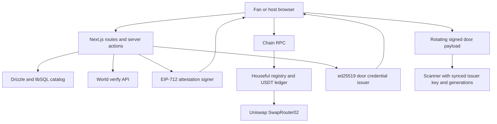

# Houseful architecture

Source reviewed through `2fe7b91` on 7 November 2026.

This describes the current implementation. [The v2 spec](specs/v2.md) is a target, and does not prove that every target flow exists. The [README](../README.md) records demo evidence and pending checks; the [threat model](threat-model.md) describes trust and failure limits.

## Components and trust boundaries

The browser sends transactions to the RPC. The web server verifies proofs, signs attestations and credentials, and serves catalog data. The contract trusts its configured `verifier` address for admission and recovery; the owner can replace that verifier. There is no on-chain World proof verifier. The scanner trusts the issuer key and generations received at sync, its clock and local admission state.

| Source | Role |
| --- | --- |
| `apps/web/src/server/catalog.ts`, `queries.ts` | Catalog reads and cached page queries |
| `apps/web/src/server/world.ts` | World request signing and proof verification |
| `apps/web/src/server/attest.ts` | 15-minute EIP-712 attestations |
| `apps/web/src/server/auth` | World identity accounts, hashed session tokens, role checks and wallet-address records |
| `apps/web/src/lib/ticket-actions.ts` | USDT approvals, ETH quotes, contract transactions and door-key binding |
| `apps/web/src/app/host/actions.ts` | Insert a listing after checking an `EventCreated` receipt |
| `packages/contracts/contracts/Houseful.sol` | Event policy, seats, ticket ownership, waitlist and recovery |
| `packages/contracts/contracts/SaleEscrow.sol` | Per-event proceeds and waitlist escrow accounting inside the registry |
| `packages/pass/src` | Credential issuance, payload generation and local verifier |

`SaleEscrow` is an inherited accounting contract, not a separately deployed escrow per show. All shows share the configured token contract and registry balance, with separate accounting entries.

## Catalog and browser state

The database stores cities, venues, hosts, events, humans, verifications, attendance, accounts, sessions and linked-wallet records. `events.chainEventId` connects a catalog row to a registry event. Catalog prices are whole dollars in `priceUsd`; `faceValueUnits` holds six-decimal USDT base units as text. City rows include country and IANA timezone. Event rows include seating and official/source URL fields.

The seed combines 28 sample shows with 21 eligible source-backed research drafts across 20 cities. Four cities have at least three bookable test listings. Existing Mumbai ids remain `1..18`, other sample shows use `19..28`, and research listings use `29..49`. These are intended ids for a controlled seeded deployment, not evidence that an arbitrary running chain contains those events.

`scripts/worldwide-catalog.ts` accepts high-confidence drafts with a numeric whole-dollar test price, parseable start value and named venue. It creates a 100-place demo allocation per research listing. Unpublished end times use an internal 24-hour booking window; unpublished doors use `0`, age uses `-1`, and venue capacity and duration use `0`. `lib/catalog-facts.ts` derives published-fact flags from the research drafts so pages do not present those internal values as official facts. Unconfirmed start times, including date-only research inputs, display “Not published”. Event pages show a test-listing notice, official seller link, published facts and separate test booking settings. Drafts are not independently verified or a live ticket-price feed.

Catalog sold counts and status are presentation data, not a live indexer. Checkout reads the chain for availability and seats. The seed deliberately allocates fewer chain tickets than the displayed venue capacity and creates synthetic holders and waiters using direct attestations. A listing's existence or a waitlist nullifier is not evidence of a real verified customer.

Search uses URL parameters for text, city, category, date, maximum price and sort. Its calendar windows use each city's timezone, and Unicode-normalized text matching runs after SQL filters. Display formatters use each city's timezone. City-page `whenWindow` still uses IST. PENDING(discovery-consistency): align any city-page calendar windows with the search rules.

`/tickets` requests past and upcoming rows for every catalog city so expired shows can still expose refund actions. It finds holdings across the catalog, but is not an index of arbitrary chain events. PENDING(wallet-discovery): tickets for uncataloged events still need a discovery path.

The active checkout and ticket-wallet signer remains the generated device wallet. Its private key and the separate ed25519 door key are in localStorage. There is no key export/import UI. `ActionSigner` supports an external signer shape for linked browser wallets.

## Accounts and sessions

Fans sign in at `/login` with a World ID Selfie Check using the `houseful-login` action. `POST /api/account/request` stores a random challenge in a ten-minute HttpOnly cookie and returns an RP request. The proof signal is `houseful:login:<challenge>`. `POST /api/account/login` verifies it, records the login, finds or creates a fan account keyed by the verified nullifier, refreshes stored credential metadata and starts a session.

Hosts sign in at `/host/login` using an injected browser wallet. `/api/account/host-challenge` creates a ten-minute cookie challenge; `/api/account/host-login` verifies a signature over the host sign-in message and creates or finds a host account keyed by the lowercased wallet address. Host login does not require World ID. Both successful login paths delete their challenge cookie. Session tokens are random 32-byte values, stored as SHA-256 hashes in the database, and expire after 30 days. The session cookie is HttpOnly, SameSite Lax, and Secure in production. Sign-in replaces the current browser session; sign-out deletes it.

`/account` and `/tickets` require a fan session; `/host` and `/host/new` require a host session. The `listShow` server action requires a host session and accepts a listing only when the contract recorded the same terms and metadata hash. Wallet-list operations check the session and record ownership, but linking does not challenge the wallet for a signature. Delinking queries `ticketOf` for all catalog chain event ids and refuses if any ticket is held. It does not check event end or cancellation, ignores waitlist places and cannot find uncataloged tickets; without a configured contract it permits removal. Selecting the active record selects the wallet that `paySigner` signs with. PENDING(account-integration): wallet possession and complete action authorization.

The host session proves the external wallet, and `hostSigner` in `pay-signer.ts` signs host transactions with that address, through the injected wallet unless it is the device wallet. The host form and console use it, and that path has not been run live. PENDING(host-signer-integration). Earlier discovery runs do not establish these new authentication or payment paths. PENDING(auth-verification).

## Verify, buy and join

1. `VerifyHuman` first calls `POST /api/attest`. A fan session with a sufficient stored credential receives an attestation using the login nullifier without another scan. This endpoint supports buy, join, claim and recover, and accepts the requested wallet without checking its linked-wallet record. For non-recovery purposes it checks `nullifierUsed`. If the session is absent or too weak, checkout falls back to World verification.
2. In the fallback, `VerifyHuman` requests an RP context from `POST /api/world/request`. The action is `houseful-login`, the same as sign-in (`worldActionFor` in `assurance.ts`), and request lifetime is 300 seconds.
3. IDKit requests Selfie Check or Proof of Human according to `assuranceFor`. Sold-out shows, or shows with capacity at least 5,000 and price at least $18, request Proof of Human.
4. `POST /api/world/verify` loads the catalog event and recomputes the required assurance. The server requires World ID protocol 4.0, the expected action/environment, exactly one response and a signal hash matching the lowercased wallet.
5. The server calls the World verify API with a 12-second timeout. It requires a successful per-proof result, matches its verified nullifier to the submitted nullifier and rejects credentials below the show's requirement. Human assurance permits the configured Orb and Document schemas; selfie assurance also permits Selfie Check.
6. The server checks `nullifierUsed` on chain, records verification metadata and signs `Attestation(eventId, nullifier, wallet, purpose, deadline)` under the `Houseful` version `1` domain, chain id and contract address.
7. The browser approves exact face value in USDT and calls `buy`, or quotes ETH and calls `buyWithEth`. After purchase, a separate `setDoorKey` transaction binds this phone's key. A failed bind does not roll back a confirmed purchase.

For a sold-out event, join deposits face value into escrow. A returned unowned ticket can be claimed at face value through the claim flow. The event-proof verification API accepts buy, join and claim; the session attestation API also accepts recover. The database retains the first verification row for each action, nullifier and purpose, so it is not a complete append-only record of attempts.

The staging World run established a server verification response, but the subsequent browser USDT approval failed at the public RPC. The transaction and approval simulations now pass `signer.client.account` so the device wallet retains local signing. PENDING(live-purchase): re-run the complete flow against the public RPC. The later second-wallet attempt received World HTTP 502 and did not establish an already-holds refusal. See the README evidence table.

## Registry rules and money

For seated events, seat ids are `1..capacity`; general admission uses seat `0`. A returned ticket keeps its reserved seat, including while unowned, so a fresh mint cannot duplicate it. Hand-back and claim preserve the ticket id and seat. PENDING(returned-seat-checkout): the seat picker disables reserved returned seats while claim mode still requires a selected seat. Contract claims are tested, but the seated checkout path needs the [integration fix](notes/contract-review.md#integration-handoff).

The registry accepts only signatures from `verifier`, checks wallet, event, purpose, chain, contract and deadline through EIP-712, then spends the digest. It enforces one active nullifier per event and one ticket or waitlist place per wallet per event. Surrender and leaving the waitlist release the active nullifier; a spent attestation remains spent.

| Transition | USDT accounting and ownership |
| --- | --- |
| Buy or returned claim | Exact face value enters proceeds; the wallet receives the ticket |
| Join | Exact face value enters waitlist escrow |
| Leave | The waiter's escrow is refunded |
| Surrender with waiter | Old holder is refunded; waiter's escrow moves to proceeds; waiter receives the same ticket and seat |
| Surrender without waiter | Holder is refunded; ticket enters the returned pool with no owner |
| Cancel | Host marks cancellation before event end; holders and waiters can pull refunds |
| Withdraw | Host drains proceeds after event end, only if not cancelled; waiter escrow stays separate |

The 64-slot waitlist scan bounds work per surrender. A backlog can make surrender revert; anyone can call `advanceWaitlist` repeatedly to skip inactive slots without dropping an active waiter. Waitlist joins extend a hash chain over the previous head, nullifier and wallet. The UI can recompute this order commitment, but it cannot prove the server fairly issued attestations.

`_swapEthForFaceValue` calls the configured SwapRouter02 for exactly face value USDT, with `msg.value` as maximum input, followed by `refundETH`. A balance delta check prevents crediting a short payment. Remaining contract ETH is sent to the caller. The browser uses QuoterV2 plus 2% headroom when configured, and a fixed local mock calculation otherwise. Pool liquidity and maximum input affect success; refunds remain denominated in USDT. See [FEEDBACK.md](../FEEDBACK.md).

## Hand-back, recovery and door keys

Surrender is available only before the event cutoff and while not cancelled. It increments generation and clears the door key. A successful recovery also increments generation, clears the key and moves ownership to the new attested wallet without changing the seat or nullifier. The session attestation API can issue recovery signatures, but there is no complete recovery UI. The event-proof API does not accept recovery. Tickets bought through event-scoped verification may have a different nullifier from account login. PENDING(recovery): validate identity continuity and provide a complete tested recovery flow.

An owner can register a door key. Changing a nonzero key to another key increments generation. Restoring a wallet on a new phone and rebinding the new door key can therefore invalidate old credentials at scanners that sync afterward.

## Door flow and offline boundary

`POST /api/pass` reads ticket owner, generation, door key and event end from chain. It compares the supplied wallet to the owner and issues an ed25519 credential for the registered holder key, expiring at event end. It does not authenticate the caller with a wallet signature. The credential alone cannot produce a valid door payload without the holder secret key.

The phone signs a payload per 20-second window. `GET /api/door/[chainEventId]/sync` returns catalog metadata, issuer public key and every minted ticket's generation. The scanner caches sync data and verifier state in localStorage, retries sync periodically while mounted and online, and can check payloads without RPC once synced. `buildDoorPayload` and `Verifier.check` are network-free operations. A service worker (`apps/web/public/door-sw.js`, registered from `components/door/offline.tsx`) caches the `/door` shell, so reloading `/door` stays usable without a network after one online visit. That is not a guarantee for a browser that has never loaded `/door`.

The verifier checks issuer signature, expiry, generation, time window and holder signature, then remembers admitted ticket ids. The app persists this state per scanner device. It does not share admissions automatically between scanners. Resetting local door state discards those admissions. A stale offline scanner can admit a surrendered or recovered generation; rotation alone does not communicate revocation.

Sync needs a catalog row and performs a chain read for every minted ticket. It does not include event cancellation in its response. PENDING(door-hardening): cancellation policy, cross-scanner synchronization, issuer pinning, bounded sync workload and state rollback review.

## Configuration and verification

Browser chain settings and server chain settings must agree, as must the generated ABI/deployment record and the deployed contract. The local deployment uses a mock router and test token; the recorded Unichain deployment uses the configured v3 router. World settings and the attester are required by `serverEnv`; door routes use the narrower `doorEnv` so they do not require World portal keys.

Contract owner, attester, faucet and door issuer are distinct roles even when development uses one environment file. The owner rotates the verifier; hosts control only their own event cancellation and withdrawal; the faucet funds test wallets. None is a substitute for a production key-management design.

Hardhat tests, randomized invariants, pass unit tests, web unit tests and Playwright specs are present. The Playwright stack substitutes World at the browser bridge and server verify API, while exercising a local chain. Some chain specs have fixture-gated skips, including the unfinished account recovery flow. On 7 November, web typecheck, 284 web tests (re-run at 08:07 IST), 83 pass tests, 55 contract tests and all 20 discovery browser checks passed. Discovery used both desktop and 375px phone layouts and a fresh production build. The full browser suite and live auth flows were not established by that run. The supplemental contract typecheck still fails in the older seed-local script because its event parameters omit `seated`. Local-node results can miss a public RPC rejecting unsigned `eth_sendTransaction`.
